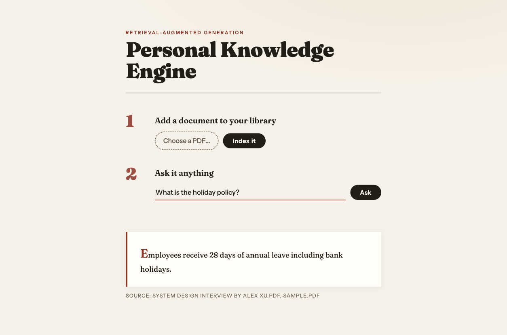

# Personal Knowledge Engine

Upload PDFs, then ask questions about their contents. Answers come from *your*
documents — retrieved by meaning, generated with sources cited — not from the
model's training data.



## How it works

Retrieval-Augmented Generation (RAG), two pipelines:

```
Ingestion  POST /upload   PDF ──> text ──> 300-word chunks ──> embeddings ──> ChromaDB
                              (pypdf)      (50-word overlap)   (MiniLM, local)

Query      POST /ask      question ──> embedding ──> 4 nearest chunks ──> LLM answer + sources
                                       (same model)  (cosine distance)   (gpt-4o-mini)
```

The grounding prompt restricts the LLM to the retrieved chunks: if the answer isn't
in your documents, it says it doesn't know instead of making something up.

## Stack

| Piece | Choice | Why |
|-------|--------|-----|
| API | FastAPI | typed request validation, auto OpenAPI docs at `/docs` |
| Vector store | ChromaDB (persistent, local) | zero-infrastructure nearest-neighbour search |
| Embeddings | Sentence Transformers `all-MiniLM-L6-v2` | free, offline, runs locally |
| Generation | OpenAI `gpt-4o-mini` | grounded Q&A is reading comprehension; small model suffices |
| UI | one static HTML file, vanilla JS | two forms and an answer card don't need a framework |

Each choice has a full decision record in [docs/adr](docs/adr/README.md).

## Quickstart

Requires Python 3.12 and [uv](https://docs.astral.sh/uv/).

```bash
uv venv --python 3.12
uv pip install -r requirements.txt

cp .env.example .env        # then put your OpenAI API key in .env

.venv/bin/uvicorn app:app --port 8010
```

Open <http://localhost:8010>, upload a PDF, ask a question.
First run downloads the embedding model (~90 MB).

## API

| Method | Path | Body | Returns |
|--------|------|------|---------|
| `POST` | `/upload` | multipart `file` (PDF) | `{"file", "chunks"}` |
| `POST` | `/ask` | `{"question", "n_results"?}` | `{"answer", "sources"}` |

Interactive docs at `/docs`. Example:

```bash
curl -X POST localhost:8010/upload -F "file=@handbook.pdf"
curl -X POST localhost:8010/ask \
  -H "Content-Type: application/json" \
  -d '{"question": "What is the holiday policy?"}'
```

## Tests

```bash
.venv/bin/python -m pytest
```

## Limitations

- Scanned/image PDFs are rejected (no OCR; the extractor needs a text layer)
- Fixed-size chunking can split tables or topic boundaries ([ADR-0003](docs/adr/0003-fixed-word-chunking-with-overlap.md))
- Single-user by design; no auth, CORS wide open — local tool posture ([ADR-0004](docs/adr/0004-single-file-application.md))

## Project layout

```
app.py          the whole backend: chunking, ingestion, retrieval, generation
index.html      the UI (served at /)
test_app.py     chunking tests
docs/adr/       architecture decision records
chroma_db/      vector store data (created on first run, gitignored)
```
